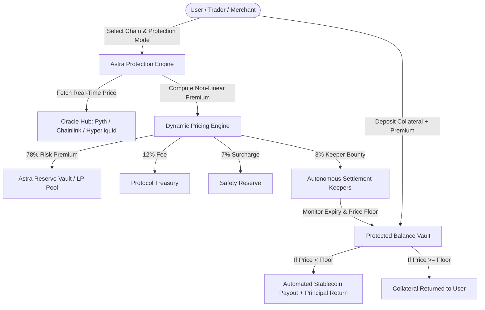

# Astra Protocol — Unified Multi-Chain Downside Protection Protocol

<p align="center">
  
</p>

<p align="center">
  <strong>Institutional-Grade Cross-Chain Loss Underwriting & Dynamic Rate Hedging</strong><br>
  Natively engineered across <strong>Solana</strong>, <strong>Arbitrum One</strong>, and <strong>Hyperliquid (HyperEVM)</strong>.
</p>

<p align="center">
  
  
  
  
  
  
  
</p>

---

## 🌟 Overview

**Astra Protocol** is a decentralized, high-throughput loss protection and dynamic hedging protocol. It provides retail traders, institutional funds, and Web3 merchants with cryptographic guarantees against asset depreciation, stablecoin depegs, and payment slippage.

Unlike traditional insurance protocols with manual claims assessment, Astra is **100% programmatic and permissionless**: payouts are computed deterministically using low-latency oracle streams (Pyth Network, Chainlink, and Hyperliquid L1 Mark Price) and settled automatically by autonomous keeper bots.

---

## 🏛️ Multi-Chain Architecture & Specification

| Specification | Details |
| :--- | :--- |
| **Supported Chains** | **Solana** (Anchor / Rust), **Arbitrum One / Sepolia** (Solidity), **Hyperliquid** (HyperEVM L1) |
| **Oracle Infrastructure** | **Pyth Network** (Solana pull oracle + Hermes API + Douro Labs institutional stream), **Chainlink** (Arbitrum), **Hyperliquid L1 Mark Price Feed** |
| **Dual Protection Modes** | **Rate Lock** (Commercial payment slippage protection) & **Depeg / Floor Shield** (Balance floor protection) |
| **Pricing Engine** | Non-Linear Duration Curve (`30`, `100`, `150`, `250` bps) + Dynamic Volatility, Reserve Utilization & Concentration Surcharges |
| **Fee Distribution** | **78%** Underwriting LP Pool &bull; **12%** Protocol Treasury &bull; **7%** Safety Reserve &bull; **3%** Automated Keepers |
| **Privacy & Security** | Cryptographic ZK BN254 pairing proofs, SHA-256 payment nullifiers, anti-replay guards, and prototype pollution defenses |
| **Web Interface** | High-end cinematic landing page (`/`), Web3 interactive app (`/app`), and comprehensive developer portal (`/docs`) |
| **Client Integration** | Official JavaScript / TypeScript SDK (`@astra-protocol/sdk`) with complete typings |

---

## 🔗 Active Testnet Deployments

### 1. Arbitrum Sepolia (Chain ID: `421614`)
* **RPC Endpoint**: `https://sepolia-rollup.arbitrum.io/rpc` (or via Alchemy)
* **Arbiscan Explorer**: [sepolia.arbiscan.io](https://sepolia.arbiscan.io)

| Contract | Address | Explorer Link |
| :--- | :--- | :--- |
| **AstraProtectionEngine** | `0x732E212e3d745a8d6493e9aB065771dDeC0f9342` | [View on Arbiscan](https://sepolia.arbiscan.io/address/0x732E212e3d745a8d6493e9aB065771dDeC0f9342) |
| **AstraReserveVault** | `0x7FdA9C1d8806495476cAa4871cB6fF663b8F1A04` | [View on Arbiscan](https://sepolia.arbiscan.io/address/0x7FdA9C1d8806495476cAa4871cB6fF663b8F1A04) |
| **AstraProtectedBalanceVault** | `0xCDF50aE966C65f3f62eE2eD53db83F6CDbab2619` | [View on Arbiscan](https://sepolia.arbiscan.io/address/0xCDF50aE966C65f3f62eE2eD53db83F6CDbab2619) |
| **AstraOracleAdapter** | `0xB1342904AcB57B803bea11a5B4691Dc8492EC433` | [View on Arbiscan](https://sepolia.arbiscan.io/address/0xB1342904AcB57B803bea11a5B4691Dc8492EC433) |
| **AstraReceiptRegistry** | `0xF481bf304CA3F8624D6F6B135ABA811283B8494C` | [View on Arbiscan](https://sepolia.arbiscan.io/address/0xF481bf304CA3F8624D6F6B135ABA811283B8494C) |
| **AstraUsernameRegistry** | `0xB90f861F38B31d726c660AEF12b7c0cb83b15c27` | [View on Arbiscan](https://sepolia.arbiscan.io/address/0xB90f861F38B31d726c660AEF12b7c0cb83b15c27) |

### 2. Solana Testnet / Devnet
* **Cluster**: `testnet` (`https://api.testnet.solana.com`)
* **Solana Explorer**: [explorer.solana.com](https://explorer.solana.com)

| Component | Identifier | Explorer Link |
| :--- | :--- | :--- |
| **Astra Anchor Program ID** | `ABMTT5W2UNn5BZG8285V9Uzn3h5c1G3rG7YeCPMn7714` | [View Program](https://explorer.solana.com/address/ABMTT5W2UNn5BZG8285V9Uzn3h5c1G3rG7YeCPMn7714?cluster=testnet) |
| **Protocol Authority** | `GBoQWwa5SWsAFcRh1NQhWQ3Avmvwgsms6MmF2jg3Verk` | [View Authority](https://explorer.solana.com/address/GBoQWwa5SWsAFcRh1NQhWQ3Avmvwgsms6MmF2jg3Verk?cluster=testnet) |
| **Pyth SOL/USD Feed** | `H6ARHf6YXhGYeQfUzQNGk6rDNnLBQKrenN712K4SEBy6` | [Pyth Network Feed](https://pyth.network/price-feeds/crypto-sol-usd) |

### 3. Hyperliquid Testnet (HyperEVM L1)
* **API Endpoint**: `https://api.hyperliquid-testnet.xyz/info`
* **WebSocket Stream**: `wss://api.hyperliquid-testnet.xyz/ws`
* **Clearing Engine Contract**: `0x732E212e3d745a8d6493e9aB065771dDeC0f9342`

---

## 🛡️ Core Capabilities



### 1. Dual Protection Modes
* **Mode A: Rate Lock (Commercial Payment Hedging)**:
  * Guarantees invoice values for set payment settlement windows (`15m`, `1h`, `24h`).
  * If asset price falls prior to settlement, recipient is automatically credited the difference in stablecoins from the underwriting reserve.
* **Mode B: Depeg / Floor Shield (Balance Downside Floor)**:
  * Users lock collateral (SOL, ETH, BTC, ARB, HYPE, or stablecoins) and pick a protective price floor (e.g. `$0.99` for stablecoins, or custom floors for volatile assets) across `1d`, `7d`, or `30d`.
  * If the asset expires below the floor, the position enters `Claimable` and pays out the difference in USDC while preserving principal.

### 2. Underwriting Liquidity Pool & LP Yield
* LPs deposit USDC into `ReserveVault` to underwrite protection policies.
* LPs receive **78% of all protocol risk premiums**, earning an estimated **11.8% APY**.
* Includes automated reserve utilization caps and 7-day withdrawal cooldowns for systemic resilience.

### 3. Cryptographic ZK Receipts & Universal Handles
* **Zero-Knowledge Receipts**: Every transaction produces a unique SHA-256 hash verified against BN254 pairing proofs, eliminating double-spending and disputed invoices.
* **Universal Username Registry**: Binds human-readable handles (e.g., `@alice`) across Solana, Arbitrum, and Hyperliquid.

---

## 📁 Repository Structure

```text
Astra/
├── index.html                   # Cinematic landing page with video background & responsive design
├── docs.html                    # Developer Documentation Portal & interactive API explorer
├── vercel.json                  # Production routing & serverless rewrites
├── package.json                 # Workspace scripts & dependency manifest
├── .gitignore                   # Security rules (strictly excludes .env and private keys)
│
├── api/
│   └── index.js                 # Vercel Serverless Function entrypoint
│
├── app/
│   ├── index.html               # Main Web3 App (Rate Lock, Floor Shield, Invoices, Reserves)
│   ├── astra-icons.bundle.js    # Optimized SVG icon sprite bundle
│   └── thinking-orbs.bundle.js  # Interactive AI/quantum state animations
│
├── assets/
│   ├── AstraLogo.png            # Official protocol brand mark
│   ├── favicon.png              # Browser favicon
│   └── fonts/                   # Dune Rise & Plus Jakarta Sans typography
│
├── contracts/
│   ├── arbitrum/                # Arbitrum One EVM Contracts (Solidity 0.8.20)
│   │   ├── AstraProtectionEngine.sol
│   │   ├── AstraReserveVault.sol
│   │   ├── AstraProtectedBalanceVault.sol
│   │   ├── AstraOracleAdapter.sol
│   │   ├── AstraReceiptRegistry.sol
│   │   ├── AstraUsernameRegistry.sol
│   │   └── interfaces/
│   │       └── IAstraContracts.sol
│   ├── solana/                  # Solana Anchor Program (Rust)
│   │   ├── Anchor.toml
│   │   ├── Cargo.toml
│   │   └── programs/astra/
│   │       ├── Cargo.toml
│   │       └── src/
│   │           ├── lib.rs
│   │           ├── state.rs
│   │           └── errors.rs
│   └── hyperliquid/             # Hyperliquid / HyperEVM Module
│       ├── contracts/
│       │   └── AstraHyperliquidEngine.sol
│       └── sdk/
│           └── hyperliquid_connector.ts
│
├── backend/                     # Multi-Chain API Daemon, Oracles & Keeper Bot
│   ├── package.json
│   ├── server.js                # Express REST API & Pyth Douro Labs stream proxy
│   ├── config.js                # Multi-chain addresses and RPC configuration
│   ├── .env.example             # Safe template for local environment variables
│   ├── services/
│   │   ├── oracle_service.js    # Oracle aggregator (Pyth Hermes, Chainlink, Hyperliquid)
│   │   ├── receipt_service.js   # Cryptographic ZK payment receipts & nullifiers
│   │   └── settlement_keeper.js # Autonomous position monitoring & settlement bot
│   └── scripts/
│       ├── test-all-backend.js  # Deep automated test suite (24 end-to-end tests)
│       ├── test-devnet.js       # Live multi-chain devnet connectivity verification
│       ├── deploy-testnet.js    # Multi-chain deployment runner & contract anchor
│       ├── setup-credentials.js # Keypair generator & RPC validator
│       └── build-icons.cjs      # SVG icon bundle generator
│
└── sdk/                         # Official Client SDK (@astra-protocol/sdk)
    ├── package.json
    ├── index.js                 # Unified JavaScript SDK implementation
    ├── index.d.ts               # Complete TypeScript type definitions
    ├── test-sdk.js              # SDK integration test suite
    └── README.md                # Comprehensive SDK documentation
```

---

## 🚀 Quickstart Guide

### 1. Prerequisites
* **Node.js**: `v18.0.0` or higher
* **npm**: `v9.0.0` or higher

### 2. Installation
```bash
git clone https://github.com/ferbisbuildin/Astra_Protocol.git
cd Astra_Protocol
npm install
```

### 3. Launch Local Backend & Settlement Keeper
```bash
npm start
```
The daemon runs at `http://localhost:4000`:
* **Landing Page**: [http://localhost:4000/](http://localhost:4000/)
* **Trading & Protection App**: [http://localhost:4000/app](http://localhost:4000/app)
* **Developer Portal**: [http://localhost:4000/docs](http://localhost:4000/docs)

---

## 🧪 Testing

### 1. Run Comprehensive Backend Test Suite
```bash
npm test
```
Executes **24 end-to-end subsystem tests** validating:
- Health check and multi-chain availability
- Pyth Douro Labs high-throughput candle feeds
- Non-linear dynamic quotation algebra
- Position lifecycle (`Create` &rarr; `Settle` &rarr; `Claim`)
- Protected invoices & payment flows
- Cryptographic ZK BN254 pairing proofs & nullifiers
- Cross-chain `@username` resolution
- Double-claim & double-payment anti-replay defenses
- Reserve liquidity deposit, LP share minting & APY calculation
- Prototype pollution & XSS injection sanitization

### 2. Run SDK Client Test Suite
```bash
npm run test:sdk
```
Validates the official `@astra-protocol/sdk` methods against the live protocol endpoints.

### 3. Test Live Multi-Chain Devnet Connectivity
```bash
npm run test:devnet
```
Tests live RPC connectivity to Solana Devnet, Arbitrum Sepolia, and Hyperliquid Testnet L1 APIs.

---

## 📦 Official Client SDK (`@astra-protocol/sdk`)

Astra Protocol includes a first-party JavaScript / TypeScript SDK located in [`sdk/`](file:///c:/Users/varda/Documents/CryptoTradeFair/Astra/sdk):

```javascript
import { AstraSDK } from './sdk/index.js';

// Initialize SDK
const astra = new AstraSDK({
  baseUrl: 'http://localhost:4000',
  defaultChain: 'solana'
});

// 1. Get a live protection quote
const quote = await astra.getQuote({
  chain: 'solana',
  asset: 'SOL',
  amount: 10,
  durationSeconds: 86400, // 24 hours
  mode: 'depeg-shield',
  floor: 95.0
});
console.log('Total Due:', quote.totalDue, 'USDC');

// 2. Open a protected position
const position = await astra.createPosition({
  chain: 'solana',
  asset: 'SOL',
  amount: 10,
  mode: 'depeg-shield',
  floorPrice: 95.0,
  durationSeconds: 86400,
  owner: 'GBoQWwa5SWsAFcRh1NQhWQ3Avmvwgsms6MmF2jg3Verk'
});
console.log('Position Active:', position.id);

// 3. Create a protected merchant invoice
const invoice = await astra.createInvoice({
  recipient: '0xe5EFDDe4bA71a8DAF740B65256B583Fb774Aa93f',
  asset: 'ETH',
  amount: 1.5,
  description: 'Annual SaaS Subscription'
});
console.log('Invoice Payment Token:', invoice.token);
```

---

## 📡 REST API Reference

| Method | Endpoint | Description |
| :--- | :--- | :--- |
| `GET` | `/api/v1/health` | Check service health and active multi-chain support |
| `GET` | `/api/v1/prices` | Retrieve real-time asset prices from Pyth and Hyperliquid |
| `GET` | `/api/v1/history?symbol=SOL` | 14-day historical candles via Pyth Douro Labs |
| `GET` | `/api/v1/quote` | Calculate dynamic risk premium and protocol fees |
| `GET` | `/api/v1/positions` | List active, settled, and claimed protection positions |
| `POST` | `/api/v1/positions` | Open a new protected balance position |
| `POST` | `/api/v1/positions/:id/settle` | Settle an expired position against current oracle price |
| `POST` | `/api/v1/positions/:id/claim` | Claim payout if position settled below floor |
| `POST` | `/api/v1/invoices` | Create a protected commercial invoice |
| `GET` | `/api/v1/invoices/:token` | Fetch invoice details and live payment status |
| `POST` | `/api/v1/invoices/:token/pay` | Settle invoice with downside rate protection |
| `POST` | `/api/v1/receipts/verify` | Verify ZK cryptographic payment proof and nullifier |
| `GET` | `/api/v1/usernames/:handle` | Resolve universal `@username` to wallet address |
| `POST` | `/api/v1/usernames` | Register universal `@username` |
| `GET` | `/api/v1/reserves` | View underwriting reserve liquidity, TVL, and LP APY |
| `POST` | `/api/v1/reserves/deposit` | Deposit USDC into reserve and mint Astra-LP tokens |
| `POST` | `/api/v1/reserves/withdraw` | Redeem Astra-LP tokens for USDC |

---

## 🌐 Production Deployment (Vercel)

Astra Protocol is pre-configured for zero-config production deployment on [Vercel](https://vercel.com):
* **Routing**: Managed by [`vercel.json`](file:///c:/Users/varda/Documents/CryptoTradeFair/Astra/vercel.json)
* **Serverless Backend**: [`api/index.js`](file:///c:/Users/varda/Documents/CryptoTradeFair/Astra/api/index.js) mounts Express routes automatically under `/api/*`
* **Static Assets**: Root and app directories are served automatically with clean URLs

To deploy using Vercel CLI:
```bash
npx vercel --prod
```

---

## 🔒 Security & Privacy

* **Strict Key Isolation**: Private keys and sensitive environment configurations are strictly excluded via [`.gitignore`](file:///c:/Users/varda/Documents/CryptoTradeFair/Astra/.gitignore). Never commit `.env` or keypair JSON files.
* **Anti-Replay Protections**: All payouts and receipts enforce unique cryptographic nullifiers.
* **Input Sanitization**: All username registrations and input payloads are sanitized against injection and prototype pollution.

---

## 📄 License

This repository is licensed under the **MIT License**. See [LICENSE](LICENSE) for details.
